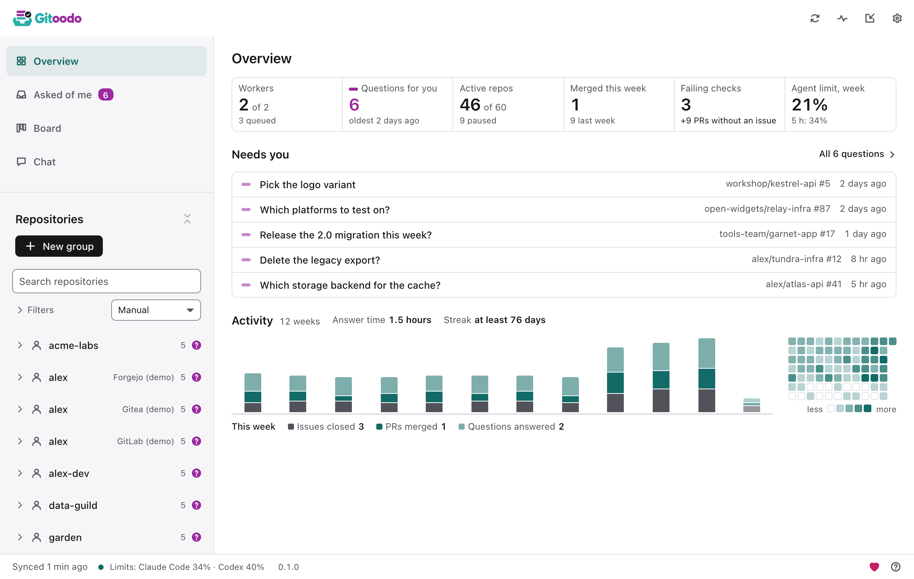
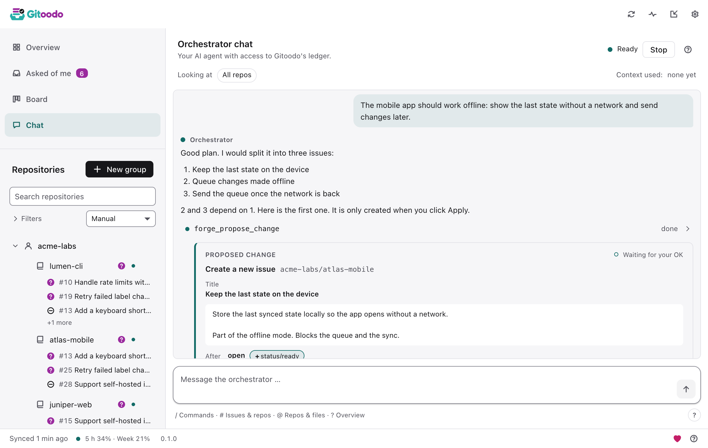
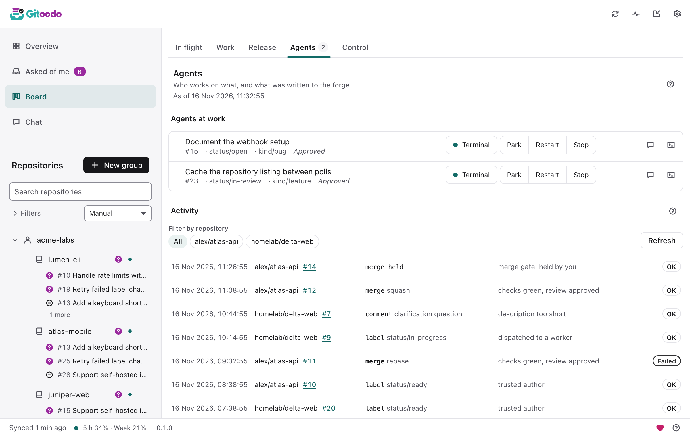
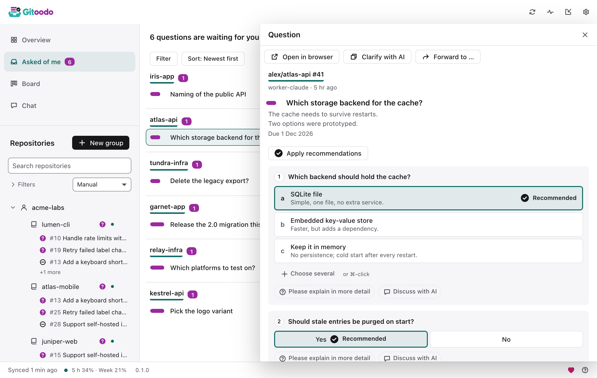

<picture>
  <source media="(prefers-color-scheme: dark)" srcset=".github/assets/gitoodo-lockup-dark.svg">
  
</picture>

### Coding agents work through your issues.

An issue-, pull-request- and Git-based orchestrator for AI coding agents. 
A coding agent starts on every ready issue, opens the pull request and Gitoodo merges it. 
When a decision is missing, the question reaches you as a card.

**Coming soon** · macOS and Windows · Forgejo, Gitea, GitHub and GitLab · Open source (MIT) from the first release

[Website](https://gitoodo.com/) ·
[Documentation](https://gitoodo.com/docs/) ·
[Get notified](https://gitoodo.com/#download) ·
[FAQ](https://gitoodo.com/docs/faq/)

 

<picture>
  <source media="(prefers-color-scheme: dark)" srcset=".github/assets/dark-15-overview.png">
  
</picture>

> [!NOTE]
> Gitoodo has not been released yet. The source code and the installers for macOS and Windows
> arrive here with the first release. Until then this repository holds only this page.
> [Get notified](https://gitoodo.com/#download) when it is out.

## What Gitoodo does

You describe what you want to build. Gitoodo breaks it down into issues with dependencies and
priorities, starts a coding agent as a **worker** for every ready issue, each in its own worktree
and branch, and merges the pull request in the style your repository allows. Your forge is the
ledger: Gitoodo has no board or database of its own, and every state can be rebuilt from issues,
labels and pull requests. You are only asked when a decision is missing.

- **Plan in the chat.** Talk through your project with the orchestrator. It proposes issues,
  labels and comments as cards, and nothing is written until you click **Apply**. Issues you write
  yourself on the forge are handled the same way.
- **One worker per ready issue.** Gitoodo reads dependencies and priorities, works out what is
  ready and starts an agent for it, on this machine or on further machines over SSH. You can watch
  every worker live, attach to its terminal, park, restart or stop it.
- **Questions as cards.** A worker that needs a decision asks in its issue. The question appears
  in your menu bar or notification area as a card with the agent's recommendation preselected;
  one click, or a short reply such as `1b 2 yes`, answers it.
- **Merged in your style.** Squash, merge, rebase or fast-forward, for all repositories or per
  repository. Afterwards Gitoodo removes the worktree and the branch.
- **Your own subscription.** Workers run the agent command-line tools you already use (Claude Code,
  Codex or Gemini CLI); no extra API key is needed.

**Direct mode** is the lighter alternative without orchestration: Gitoodo then only collects what
is waiting for you across repositories and accounts (questions, issues, pull requests, status
labels), with a tray counter and notifications.

## How it works

1. **Issues.** You write them yourself or plan them in the chat. Labels, dependencies and
   priorities (p0 to p3) decide what is ready; Gitoodo maintains the status labels `ready`,
   `in-progress`, `in-review` and `blocked`.
2. **Workers.** For every ready issue an agent starts in its own worktree. A lease keeps two
   agents from taking the same issue, and a worker that hangs is restarted.
3. **Questions.** When the agent needs a decision, it asks in the issue in an
   [open, versioned question format](https://gitoodo.com/spec/questions/v2/).
   You answer from the card; the answer goes back to the issue as a short comment.
4. **Merge.** The pull request is kept up to date and merged in your repository's style. Only a
   real merge conflict lands with you.

## A closer look

**Plan in the chat.** Proposals arrive as cards; nothing is written until you click Apply.

<picture>
  <source media="(prefers-color-scheme: dark)" srcset=".github/assets/dark-05-chat.png">
  
</picture>

**Steer the workers.** Every running agent with its terminal, and everything Gitoodo wrote to the forge.

<picture>
  <source media="(prefers-color-scheme: dark)" srcset=".github/assets/dark-06-workers.png">
  
</picture>

**Answer in one click.** The agent's recommendation is preselected.

<picture>
  <source media="(prefers-color-scheme: dark)" srcset=".github/assets/dark-03-question-card.png">
  
</picture>

## Platforms

|             | Supported                                                                      |
| ----------- | ------------------------------------------------------------------------------ |
| **macOS**   | 11 or later, Apple silicon                                                     |
| **Windows** | 10 (2004 or later) and 11, x64                                                 |
| **Linux**   | planned                                                                        |
| **Forges**  | Forgejo, Gitea, GitHub and GitLab, self-hosted too; several accounts per forge |
| **Agents**  | Claude Code, Codex or Gemini CLI, with your own subscription                   |

Network access happens only in Gitoodo's Rust core and only towards the forge servers you
configure. Tokens stay in the system's secret store (macOS keychain, Windows Credential Manager),
never in files.

## Stay in touch

- **Get notified:** use the [contact form on the website](https://gitoodo.com/#download)
  and we let you know when the first release is out.
- **Questions or ideas:** the same contact form reaches us by email.
- **Documentation:** [silvio-l.github.io/gitoodo/docs](https://gitoodo.com/docs/), in
  six languages.
- **Security:** please report vulnerabilities privately, see [SECURITY.md](SECURITY.md).
- **Support:** if you would like to support the development, the **Sponsor** button of this
  repository lists the ways. Supporting unlocks nothing; every feature works the same without it.

## Licence

Gitoodo will be released as open source under the [MIT licence](LICENSE), with the source code from
the first release on. Contributions will be welcome then; until then, see
[CONTRIBUTING.md](CONTRIBUTING.md). Everyone taking part follows the
[Code of Conduct](CODE_OF_CONDUCT.md).

Made by Silvio and Maik.
